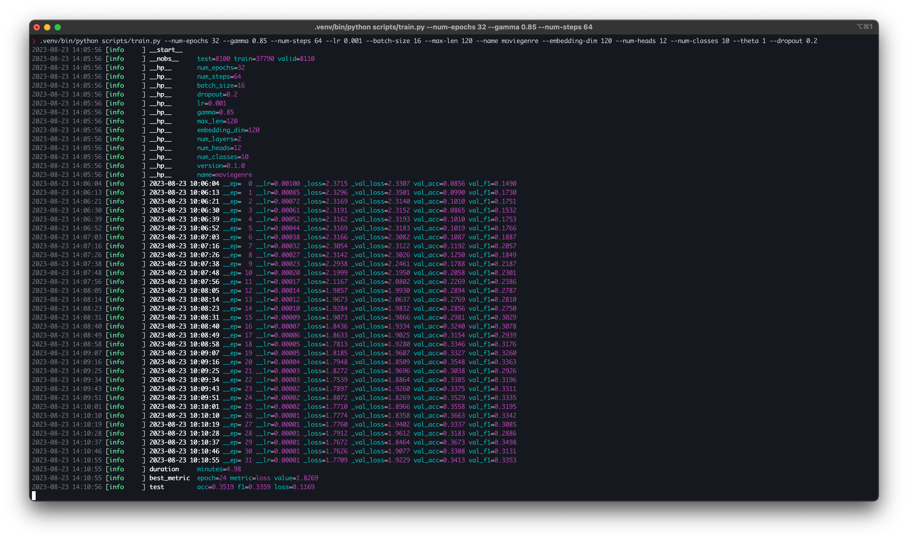

# Information Quality

Fine-tune pretrained transformers (DistilBERT, RoBERTa, DeBERTa, ...) to
classify text, e.g. the quality of natural language as "high" or "low".

The repo has two parts:

| Path        | What it is                                                          |
|-------------|---------------------------------------------------------------------|
| `model/`    | The `infoquality` Python package: model, save/load, and `Predictor` |
| `training/` | Scripts to train (`train.py`), predict (`predict.py`), and sweep (`run.py`) |

## Installation

Requires Python 3.10+.

```bash
make develop   # creates .venv and installs model[training,dev] + pre-commit hooks
```

Or install just the package (for inference) with `pip install ./model`.

## Training

Training data can be `.parquet`, `.csv`, `.tsv`, `.json`, or `.jsonl` files
with a text column and a label column. Labels can be any strings; the number
of classes is inferred from the training data.

```bash
.venv/bin/python training/scripts/train.py \
    --train-path data/train.parquet \
    --valid-path data/valid.parquet \
    --test-path data/test.parquet \
    --text-col text \
    --label-col label \
    --model distilbert-base-uncased \
    --num-epochs 32 \
    --num-steps 0 \
    --lr 0.0001 \
    --batch-size 128 \
    --name infoquality
```

- Without `--valid-path`, `--valid-size` (default 10%) of the training data is
  held out for validation. Without `--test-path`, no test set is evaluated.
- `--dataset imdb` trains on IMDB sentiment from the Hugging Face hub instead.
- `--fraction 0.1` subsamples the training/validation data for quick runs.
- `--num-steps N` limits each epoch to `N` training batches (`0` = full epoch).
- `--best-metric loss|acc` picks the metric for early stopping
  (`--early-stopping-patience`) and learning rate decay (`--gamma`,
  `--lr-patience`). The weights from the best epoch are the ones saved.
- `--device` defaults to `auto` (CUDA, then Apple MPS, then CPU).
- Run `train.py --help` for all options. Hyperparameter defaults are in
  [`HyperParameters`](model/src/infoquality/hyperparameters.py).

Models are saved to `{--output-dir}/{name}/{version}/` (default output dir:
`$INFOQUALITY_OUTPUT_DIR` or `./models`):

| File                   | Contents                                          |
|------------------------|---------------------------------------------------|
| `state_dict.pt`        | Model weights                                     |
| `hyperparameters.json` | Hyperparameters                                   |
| `model.json`           | Model version and label map                       |
| `metrics.json`         | Per-epoch training/validation metrics, best epoch, and test metrics |



## Prediction

In Python:

```python
from infoquality import Predictor

predictor = Predictor("models/infoquality/0.1.0.20260101120000")
predictor.predict(["Some text to classify", "another"])
# [Prediction(label='high', proba=[0.88, 0.12]), ...]
predictor.labels  # order of the probabilities, e.g. ['high', 'low']
```

Or for a whole file:

```bash
.venv/bin/python training/scripts/predict.py \
    --model-dir models/infoquality/0.1.0.20260101120000 \
    --input data/unlabeled.parquet \
    --output predictions.csv \
    --keep-cols id \
    --proba
```

## Models

Any Hugging Face model that supports `AutoModelForSequenceClassification` can
be fine-tuned with `--model`, for example:

| pretrained_model                          |   parameters |   size_mb |
|-------------------------------------------|-------------:|----------:|
| albert-base-v2                            |   11,692,290 |      44.6 |
| albert-large-v2                           |   17,716,052 |      67.6 |
| bert-base-cased                           |  109,490,954 |     417.7 |
| bert-base-uncased                         |  109,490,954 |     417.7 |
| distilroberta-base                        |   82,127,118 |     313.3 |
| distilbert-base-cased                     |   65,797,606 |     251.0 |
| distilbert-base-multilingual-cased        |  135,332,874 |     516.3 |
| distilbert-base-uncased                   |   66,961,674 |     255.4 |
| distilbert-base-uncased-distilled-squad   |   66,961,674 |     255.4 |
| distilgpt2                                |   82,118,922 |     313.3 |
| microsoft/deberta-base                    |  139,200,522 |     531.0 |
| roberta-base                              |  124,654,350 |     475.5 |
| roberta-base-openai-detector              |  124,654,350 |     475.5 |
| squeezebert/squeezebert-mnli-headless     |   51,102,474 |     194.9 |

`--num-layers` and `--num-dims` override the architecture. Note that changing
`--num-dims` discards the pretrained weights of the resized layers.

## Development

```bash
make test     # pytest (with coverage) for model/ and training/
make lint     # ruff check + ruff format --check
make format   # auto-fix lint and formatting
```

Tests use a tiny randomly initialized model from the Hugging Face hub, so they
run in seconds on a CPU (the first run needs network access to download it).
